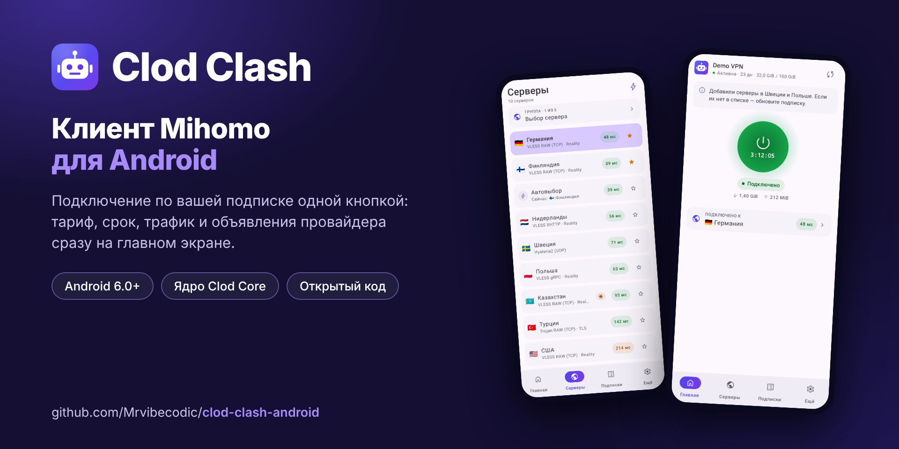

  

<h1 align="center">Clod Clash для Android</h1>

  <a href="https://mrvibecodic.github.io/clod-clash-android/ru/docs">Документация</a> ·
  <a href="https://mrvibecodic.github.io/clod-clash-android/ru/download">Скачать APK</a> ·
  <a href="https://mrvibecodic.github.io/clod-clash-android/en/docs">English docs</a> ·
  <a href="./PRIVACY_POLICY.ru.md">Конфиденциальность</a>

  
  &nbsp;
  

Клиент Mihomo для Android: подключение по вашей подписке одной кнопкой, тариф, срок, трафик и
объявления провайдера — сразу на главном экране. Сделан под панель Remnawave. Внутри —
[Clod Core](https://github.com/Mrvibecodic/clod-core), наш форк стабильного
[mihomo](https://github.com/MetaCubeX/mihomo). Android 6.0 и новее.

Версия для Windows, macOS и Linux — в репозитории
[clod-clash](https://github.com/Mrvibecodic/clod-clash).

## Провайдеру

- [Настройка панели](https://mrvibecodic.github.io/clod-clash-android/ru/docs/provider/panel) —
  правило в Subscription response rules Remnawave.
- [Заголовки подписки](https://mrvibecodic.github.io/clod-clash-android/ru/docs/provider/headers)
  и [заголовки clod-*](https://mrvibecodic.github.io/clod-clash-android/ru/docs/provider/clod-headers).
- [Ядро Clod Core](https://mrvibecodic.github.io/clod-clash-android/ru/docs/provider/core) —
  чем оно отличается от стокового mihomo.

## Основа и лицензия

Оболочка приложения выросла из
[ClashMetaForAndroid](https://github.com/MetaCubeX/ClashMetaForAndroid) и
[ClashForAndroid](https://github.com/Kr328/ClashForAndroid) (Kr328), история сохранена.
Интерфейс написан заново на Jetpack Compose.

GPL-3.0 — см. [LICENSE](LICENSE). Лицензии сторонних компонентов — в [NOTICE](NOTICE).
